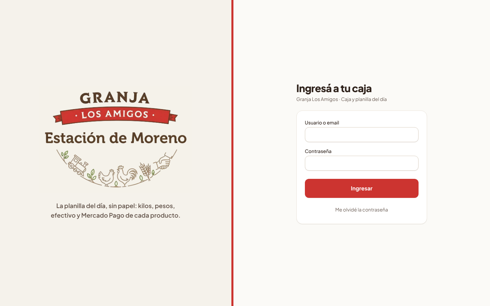
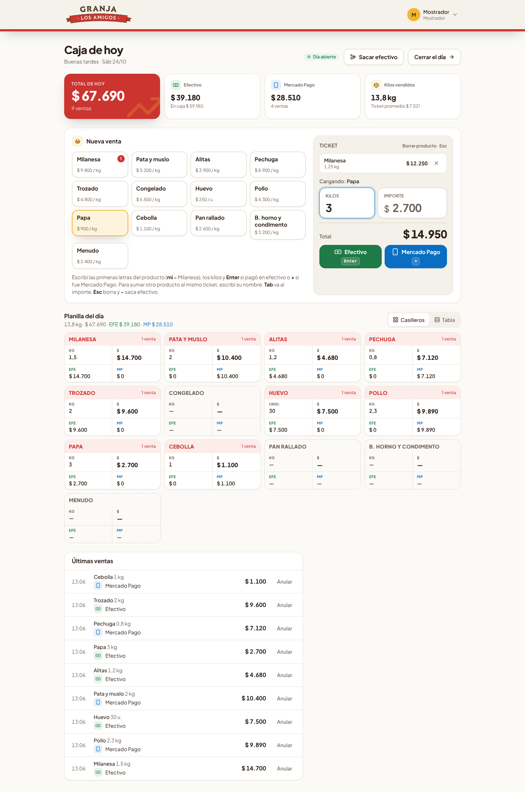
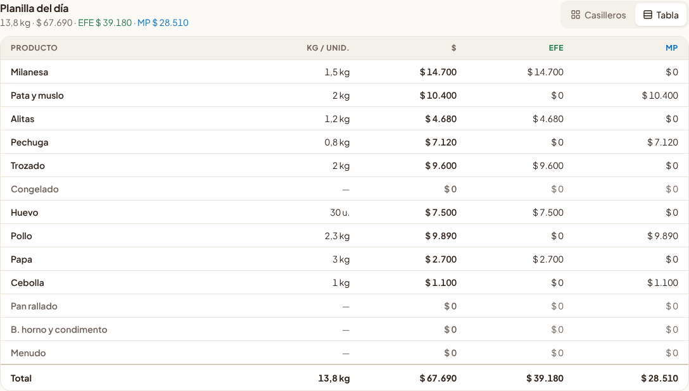
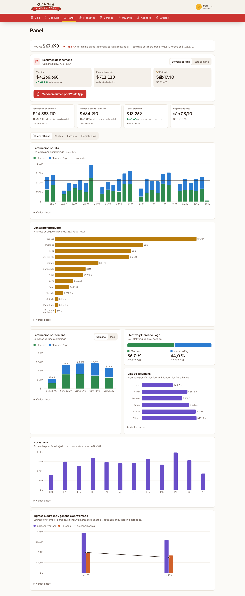

# Guía rápida de Granja Los Amigos

Una página para usar la app todos los días. Es la **planilla del día** de siempre (Kg · $ · EFE · MP por producto), pero se llena sola mientras cargás las ventas.

## 1. Entrar

Abrí la app (el ícono del gallo en la compu o el celular del local). Escribí el usuario (por ejemplo `mostrador`) o tu email, la contraseña, y tocá **Ingresar**.
La sesión queda abierta todo el día; se cierra sola si pasan 12 horas sin usarla.

## 2. Abrir el día (a la mañana)

Si todavía no se abrió la caja, aparece **Abrir el día**. Si arrancás con plata para el cambio, escribila; si no, dejalo en 0. Apretá **Enter**.

## 3. Cargar una venta

El cursor ya está en el campo **Kilos**: no hace falta hacer clic.

1. **Elegí el producto** escribiendo las primeras letras: `mi` = Milanesa, `pe` = Pechuga, `pol` = Pollo, `pap` = Papa, `hue` = Huevo. (O tocá el producto en la pantalla.)
2. **Escribí los kilos** (con coma: `1,250`). Si el producto tiene precio, el importe se calcula solo.
   - ¿Te pidieron "$ 5.000 de papa"? Apretá **Tab**, escribí el importe y los kilos se calculan solos.
   - ¿Huevos? Se cargan por **unidad** (`12`, `30`).
3. Apretá:
   - **Enter** si pagó en **efectivo**.
   - **+** si pagó con **Mercado Pago**.

Eso guarda la venta. Aparece "✓ Venta guardada" abajo a la derecha, el total sube y la planilla se actualiza.

**Varios productos en la misma venta:** después de los kilos del primero, escribí las letras del siguiente (`mi 1,5` → `pap 2` → **Enter**). Se van sumando al **Ticket** de la derecha y se cobran juntos. Para sacar uno, tocá la ✕.

**Si te equivocaste:** **Esc** borra el producto que estás cargando (otra vez Esc vacía el ticket). Una venta ya guardada se corrige con **Deshacer** en el aviso o **Anular** en la lista (tenés 10 minutos).

**Vuelto:** después de una venta en efectivo aparece **"¿Con cuánto pagó?"**. Tocá el billete y te muestra el vuelto.

Si una venta es muy grande (más de $ 300.000), la app pregunta si está bien: **Enter** para guardar, **Esc** para corregir.

**Si dice "Sin internet":** la venta **no** se guardó. El ticket queda cargado; cuando vuelva la conexión, apretá Enter o + de nuevo.

En el celular también anda: tocás el producto, escribís los kilos y tocás **Efectivo** o **Mercado Pago**.

## 4. La planilla del día

Debajo de la carga está la **Planilla del día**, igual que la hoja de papel: para cada producto, **Kg**, **$**, **EFE** (efectivo) y **MP** (Mercado Pago). Arriba de todo, el total, el efectivo, Mercado Pago y los kilos vendidos.
Con **Tabla** la ves en filas, con el total abajo.

## 5. Pagarle al proveedor o sacar plata de la caja

1. Apretá **−** (la tecla de restar) o tocá **Sacar efectivo**.
2. Escribí cuánto sacaste y elegí para qué: **Pago a proveedor**, **Retiro del dueño**, **Gasto del local** u **Otro**.
3. Apretá **Enter**.

Esa plata se descuenta de lo que tiene que haber en la caja. El pago a proveedor y el gasto del local quedan también en **Egresos**.

## 6. Cerrar el día (a la noche)

1. Tocá **Cerrar el día**.
2. Contá la plata de la caja (incluido el fondo inicial), escribila y apretá **Enter**. También podés **Contar billete por billete**.
3. La app te dice si **coincide**, si **sobra** o si **falta**. Si no coincide, escribí una nota.
4. Apretá **Enter** otra vez para confirmar.

Al cerrar aparece **Mandar resumen por WhatsApp**: el total, efectivo, Mercado Pago y **cuánto se vendió de cada producto**.
Después de cerrar no se pueden cargar ventas de ese día; un administrador lo puede **reabrir** (queda anotado).

## 7. Para el dueño (administradores)

En las pestañas de arriba aparecen más secciones:

- **Consulta:** cualquier día, semana o mes, con su **planilla por producto** y comparado con el período anterior. En el mes está **Descargar PDF para el contador** y **Descargar Excel** (con una hoja de la planilla por producto).
- **Panel:** resumen de la semana para mandar por WhatsApp, ventas por día, **ventas por producto**, efectivo vs. Mercado Pago, días y horas en que más se vende, ingresos y gastos.
- **Productos:** los productos de la planilla, con su **precio por kilo** (o por unidad), el orden y si se venden. Cambiar un precio no toca las ventas ya cargadas, y queda en la auditoría.
- **Egresos:** lo que se paga (mercadería, alquiler, luz, sueldos). Se anulan con motivo, no se borran.
- **Usuarios:** crear cuentas (por ejemplo `mostrador`), cambiar contraseñas y desactivar a quien ya no trabaja.
- **Auditoría:** quién anuló, cerró, reabrió o cambió un precio, y cuándo.
- **Ajustes:** el WhatsApp al que va el resumen y el importe a partir del cual la caja pide confirmación.

## Si algo no anda

- **No puedo entrar:** revisá el usuario y la contraseña. Si te la olvidaste, el dueño te pone una nueva desde **Usuarios**.
- **Un producto no aparece en la caja:** en **Productos**, fijate que esté marcado "Se vende".
- **Se ve todo raro o viejo:** cerrá la app y abrila de nuevo (se actualiza sola).
